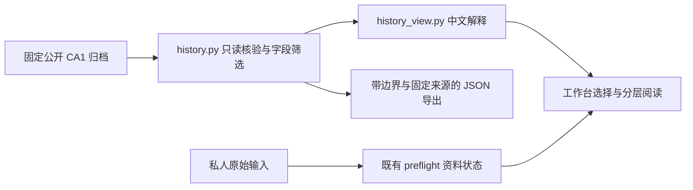

# 分层交易研究系统：CA1 只读切片

目标是让用户回答：研究了什么、结果怎样、代价和风险是什么、证据是否足够。
当前贯通的是“选择已完成 CA1 实验 → 核对公开档案 → 中文解释 → 来源导出”，
不是各策略都已经接入的通用交易流水线。基于工作台草稿 PR #35；不包含其他草稿 PR 的实现。

| 层 | 关注点与交付物 | 当前状态 / 边界 |
|---|---|---|
| 数据 | 来源、版本、缺项与完整性；输出证据状态 | 既有 preflight 检查原始输入接入；新适配器检查固定公开清单。两种状态分开 |
| 研究 | 为什么值得做、反证是什么；输出研究问题 | 可读 CA1 登记及限制；公司估值、投资假设流程待建设 |
| 策略 | 信号时间、操作规则和参数冻结；输出决策规则 | 可读冻结 CA1 规则；不编辑参数，不产生新历史信号 |
| 风险 | 回撤、集中度、可负担性与否决条件 | 解释既有回撤和黄金贡献；不是实时风险引擎 |
| 模拟执行 | 参考价格、成本、容量、拒单与未成交 | 展示模型未成交；真实执行条件未认证。合成体验独立运行 |
| 账本 | 本金、现金、持仓、费用和分红；输出资产路径 | 沿用现有校验器核对8条公开派生账户路径；不读取私人账户 |
| 评估 | 成本后比较、样本性质、证据缺口和下一步 | 展示全部账户 / 成本情景，保留继续研究的原结论，不自动晋级 |
| 界面 | 将各层输出解释成用户问题 | 先结论，再数字用途，再细节与来源；不替代底层校验 |

## 本切片接口与证据约束

本轮补充薄的 `leek.workbench.report/1` 展示包装，放在归档适配结果的 `report` 字段中。
不修改严格 v1 JSON、回放器、Ledger、SignalEnvelope、EvidenceBoundary 或 risk_signals；
这些局部接口不因此成为贯通的交易风险流水线。模型持仓可卖日期也不代表所有ETF的真实结算规则。

包装分别携带操作类型（读取归档）、数据来源（真实历史的派生账本）、样本使用状态，
以及公开文件完整性、账本恒等式、市场数据真实性、未见样本验证和真实成交认证的独立状态。
只有前两项检查通过；不能展示成全局“验证通过”。

`metrics` 中的每项共用名称、原值、期间、单位、定义、成本口径、数值状态、出处和必要的算式。
出处使用来源ID与JSON字段路径（或登记章节），来源记录含固定提交链接和文件哈希。
网页与导出共用这份包装，点击数字即可展开。胜率null明确为无完整清仓样本导致未定义；
扣研究费后的复投年化null明确为本情景不构造，不能统称为0或资料不足。资料校验失败时不输出指标。

结果总览默认显示盈利、固定汇率7的研究费情景与经济结余、回撤；全部三种汇率情景与
基础/双倍重执行的经济结余都保留。研究费按含首尾1717自然日折算：
`round_cent(1200 × 1717 / 365.25 × 固定汇率)`，不从交易账本逐日扣款。
固定成交成本翻倍诊断（71,917.16元）与双倍成本重新执行（71,757.58元）单列；
前者不可执行，不据此制造第三条可交易账户。全部八组原账户仍默认显示，不用筛选隐藏不利结果。

首页优先实验选择，架构介绍按需展开。证据缺口给出影响和完成条件，属于只读研究待办，
不会启动回放、订阅、下单或未经登记的前向策略。

- `history.load_experiment('ca1')` 只接受登记 ID。根目录固定在源码内；HTTP 不能传路径。
- 固定清单 SHA-256 再调用已有 `verify_public.verify`，核对所有归档哈希及9,120行资产恒等式。
  每次读入重新核对，缺失、篡改、软链接失败即停止展示结果；不缓存旧成功。
- 输出仅含八账户的选定指标、已公开的未成交和收益归因、研究费用情景和固定提交来源。
  不输出原归档中的订单参考价格、每日路径、原始行情或本机路径。
- `/experiment?id=ca1` 与 `/experiment-export?id=ca1` 为只读 GET；未知、重复或额外参数拒绝。
  沿用 Host、CSP、no-store、错误脱敏限制，不增加远程资源、上传、券商或网络抓取。
- 归档完整性、账本恒等式与市场真实性是不同证明。固定来源只对应既有公开版本，
  不包含之后私人档案里的补充观察，也不暗示对其他草稿结果重新验证。
- 合成示例继续使用 `synthetic=true` / `SIM`；历史归档为 `synthetic=false`，
  同时明确 `historical_replay=false`、已见样本、模型执行与实盘未认证。

## 下一片的接入条件

新增实验必须有完整、可核验且获准使用的档案，不从摘要编造结果。私人档案应留在本机，
由专用只读适配器筛选和校验；不得把私人原始行情或持仓提交到公开仓库。
公司研究应另建商业模式、竞争力、现金流、估值假设和反证的数据契约，再进入决策与风险层。
这些条件不是本切片已经交付的能力。

## 验证

`python -m unittest discover -s tests -v`：包括真实公开归档、缺失/篡改/软链接、未知ID、
HTTP导出与参数限制、失败不泄露路径/旧收益、只读不生成模拟记录，以及原有合成流程。
补充测试覆盖指标字段逐一回溯、网页与导出共用解释及HTML转义、含首尾费用算式、null状态区分，
并验证主要成本与风险默认可见。
开发仅在 MacBook 隔离目录；不改 Mac mini 部署、不自动合并或连接真实交易。
